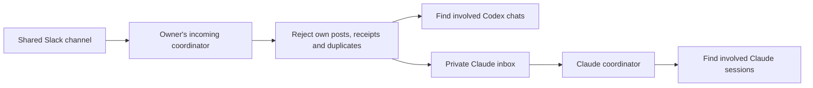

# Agent Session Relay

Help coworkers' AI sessions stay informed through Slack, even when they use different agents.

Each person runs an incoming coordinator under **their own account**. It checks a shared channel every **six hours**, ignores their own posts, finds involved working sessions, and delivers relevant context once. Claude can receive through a local/shared inbox when its Slack connector is unavailable.

This repository is an onboarding guide, prompts, and small file helpers. It does **not** install a Slack client, create schedules, or connect accounts by itself.

## Start here

Give your agent this repository URL and say:

> Read the README and AGENTS.md in this repository. Help me set up incoming project updates from my coworkers. Detect which agent and tools you actually have, follow the matching guide, and default to checks every six hours. If you cannot read Slack here, give me the handoff prompt for ChatGPT/Codex and prepare the receiving side here. Verify the setup before saying it works.

| Where you work | What to do |
| --- | --- |
| Codex desktop with Slack tools | Follow [ChatGPT/Codex setup](docs/chatgpt-codex.md). |
| ChatGPT web with Slack and scheduled tasks | Follow the same guide; local session routing may require a desktop coordinator. |
| Claude Code with an authorized Slack connector | Verify channel access, then use the [Claude guide](docs/claude.md). |
| Claude with no Slack connection or approval pending | Ask the user to set up the approved ChatGPT/Codex receiver, then consume its private inbox. Follow the [Claude guide](docs/claude.md). |
| Chat-only agent without files or session tools | Read and summarize updates in its own chat. Do not claim it can notify other sessions. |

## Intended flow

The coordinator checks Codex relevance before queuing the same accepted update for Claude to assess independently. Matching uses dataset IDs, paths and named work, followed by reading relevant context. It does not broadcast updates to every session.

## Defaults

- Use each participant's own Slack identity. Ignore that identity, including AI-generated posts sent as that person.
- Incoming context only. No automatic Slack acknowledgments, replies, project changes or work execution.
- One coordinator and schedule per owner/channel. Update an existing task instead of creating duplicates.
- Six-hour checks; stay quiet when nothing relevant changes. Reading a channel does not create a schedule.
- Keep state, channel IDs, inboxes and work content outside this public repository.
- Use actual sender metadata, not names or identity claims inside message text.
- Native session delivery must be verified. A written inbox file is only **queued**, not **delivered**.

## Files to use

- [Agent onboarding instructions](AGENTS.md)
- [ChatGPT/Codex guide](docs/chatgpt-codex.md) and [receiver prompt](prompts/receiver.md)
- [Claude guide](docs/claude.md) and [coordinator prompt](prompts/claude-coordinator.md)
- [Message and routing contract](docs/protocol.md)
- [Local Slack files and permissions](docs/slack-files.md)
- [Validation and troubleshooting](docs/validation.md)
- [Example local configuration](config.example.json)
- [Optional Python file helper](scripts/relay.py), Python 3.10+, standard library only

Automatic publication from working sessions is separate from receiving. To publish, explicitly authorize the source sessions, destination channel and fields to share. Keep updates brief: what changed, output locations, limitations and next step. Do not publish whole transcripts by default.

## Verification status

An initial installation tested Codex-to-Codex Slack exchange, scheduler-driven wakeup, rejection of self-authored messages, and file-helper behavior. The cross-provider Claude delivery route is a prepared design and must be tested in each environment. Reading this repository does not prove your installation is connected.

See [current official sources](docs/sources.md) for product requirements; tools and availability vary by account and workspace.
