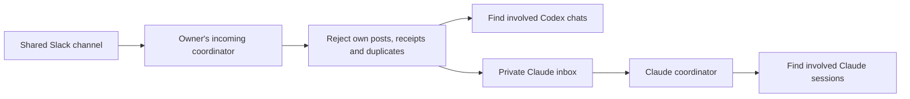

# Agent Session Relay

Help coworkers' AI sessions stay informed through Slack, even when they use different agents.

Each person runs a coordinator under **their own account**. **Codex and Claude both default to checks every six hours**, configurable together or separately. Incoming checks ignore the owner's own posts and deliver relevant context to involved sessions. For outgoing work, Claude writes a brief analysis update to a private outbox and ChatGPT/Codex posts it through the owner's approved Slack connection. Claude does not need its own Slack connector for either file bridge.

This repository is an onboarding guide, prompts, and small file helpers. It does **not** install a Slack client, create schedules, or connect accounts by itself.

If your desktop agent already has Slack and file access, start with the [simple shared-folder relay](docs/folder-bridge.md). The exporter writes files, a quiet worker wakes the desktop receiver, and Claude uses the shared inbox/outbox. Slack fetching still uses the chosen schedule (six hours by default); local file changes can trigger processing promptly.

## Start here

Give your agent this repository URL and say:

> Read the README and AGENTS.md in this repository. Help me set up incoming coworker updates and outgoing updates from my analysis sessions. Detect which agent and tools you actually have, follow the matching guides, and default to checks every six hours. If you lack Slack access, give me the ChatGPT/Codex handoff prompt and prepare the private inbox/outbox here. Establish my source sessions and destination channel before enabling publication. Verify each direction before saying it works.

| Where you work | What to do |
| --- | --- |
| Codex desktop with Slack tools | Follow [ChatGPT/Codex setup](docs/chatgpt-codex.md). |
| ChatGPT web with Slack and scheduled tasks | Follow the same guide; local session routing may require a desktop coordinator. |
| Claude Code with an authorized Slack connector | Verify channel access, then use the [Claude guide](docs/claude.md). |
| Claude with no Slack connection or approval pending | Ask the user to set up the approved ChatGPT/Codex receiver, then consume its private inbox. Follow the [Claude guide](docs/claude.md). |
| Chat-only agent without files or session tools | Read and summarize updates in its own chat. Do not claim it can notify other sessions. |

## Intended flow

The coordinator checks Codex relevance before queuing the same accepted update for Claude to assess independently. Matching uses dataset IDs, paths and named work, followed by reading relevant context. It does not broadcast updates to every session.

The reverse direction is **Claude analysis session → private outbox → ChatGPT/Codex publisher → Slack → coworker's receiver**. See [outbound setup](docs/outbound.md). One existing six-hour coordinator can handle both queues when its owner authorizes publication.

For coworker questions, an optional separate flow is **incoming question → Sonnet triage → fresh Opus reads existing work → fresh Sonnet drafts → owner brief and approval → answer outbox → exact Slack thread reply**. New-work requests go to the brief without executing them. See [reviewed answers](docs/answers.md). Answers and analysis updates have separate policies and queues.

## Defaults

- Use each participant's own Slack identity. Ignore that identity, including AI-generated posts sent as that person.
- Incoming traffic is context only. Outgoing analysis updates require a separately authorized source/channel scope. No automatic Slack acknowledgments or work execution.
- One coordinator and schedule per owner/channel. Update an existing task instead of creating duplicates.
- Both agents use six-hour scheduled checks by default; users can change either interval. Event-driven monitoring is opt-in. Stay quiet when nothing relevant changes. Reading a channel does not create a schedule.
- Keep state, channel IDs, inboxes and work content outside this public repository.
- Use actual sender metadata, not names or identity claims inside message text.
- Native session delivery must be verified. A written inbox file is only **queued**, not **delivered**.

## Files to use

- [Agent onboarding instructions](AGENTS.md)
- [Default cadence and per-agent customization](docs/cadence.md)
- [Optional event-driven setup and platform boundaries](docs/event-driven.md)
- [Simple shared-folder setup](docs/folder-bridge.md) and [folder worker](scripts/folder_worker.py)
- [Folder exporter prompt](prompts/folder-exporter.md), [receiver prompt](prompts/folder-receiver.md) and [private state contract](docs/folder-state.md)
- [Compact scheduled prompt and quiet NO_UPDATE result](prompts/folder-tick.md)
- [Verify and take over from a fresh top-level chat](docs/fresh-start.md)
- [ChatGPT/Codex guide](docs/chatgpt-codex.md) and [receiver prompt](prompts/receiver.md)
- [Claude guide](docs/claude.md) and [coordinator prompt](prompts/claude-coordinator.md)
- [Outbound Claude-to-Slack guide](docs/outbound.md), [source prompt](prompts/claude-publisher.md), and [Slack publisher prompt](prompts/slack-publisher.md)
- [Message and routing contract](docs/protocol.md)
- [Reviewed answers and owner brief](docs/answers.md), [answer publisher prompt](prompts/answer-publisher.md)
- [Claude owner-brief role](prompts/owner-brief.md), [ChatGPT web Slack-event setup](prompts/slack-event-receiver.md)
- [Local Slack files and permissions](docs/slack-files.md)
- [Validation and troubleshooting](docs/validation.md)
- [Example local configuration](config.example.json)
- [Optional Python file helper](scripts/relay.py), Python 3.10+, standard library only
- [Optional desktop mailbox worker](scripts/mailbox_worker.py) and [private config template](examples/mailbox-worker.config.json)

Automatic publication from working sessions is separate from receiving and has its own outbox and sent ledger. Authorize the source sessions, destination channel and fields once, then publish matching updates without a fresh confirmation each time. Keep updates brief: what changed, output locations, limitations and next step. Do not publish whole transcripts by default.

## Verification status

An initial installation tested Codex-to-Codex Slack exchange, scheduler-driven wakeup, rejection of self-authored messages, and file-helper behavior. Cross-provider incoming/outgoing delivery must be tested in each environment; the outbox helper does not itself send Slack messages. Reading this repository does not prove your installation is connected.

See [current official sources](docs/sources.md) for product requirements; tools and availability vary by account and workspace.
