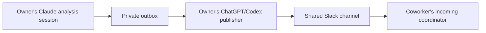

# Claude analysis to ChatGPT/Codex to Slack

The return path is a private **outbox**. Claude writes a short update as a normal file; the owner's ChatGPT/Codex publisher reads it and uses the owner's approved Slack connection to post it. Claude does not need its own Slack connector.

This is separate from incoming filtering: incoming readers ignore the owner's own Slack ID, while the publisher accepts explicitly authorized **local analysis** updates. The publisher is not an acknowledgment bot and does not turn coworkers' messages into outgoing posts.

## One-time scope

The owner authorizes the source analysis sessions, destination workspace/channel, shareable fields and cadence. Save that policy in private configuration, never in the public repository or inside a Slack message. After this scope is authorized, matching updates do not need a new confirmation each time. Keep outbound disabled until that scope exists.

Both Claude analysis-update collection and Codex publication default to **every six hours**. Users can change the shared cadence or override either agent independently; see [cadence configuration](cadence.md). Staging a new file at a milestone does not change the configured check/publication interval.

Suggested owner instruction:

> Relay brief progress updates from [SOURCE CLAUDE SESSION IDS] to [SLACK CHANNEL]. Share what changed, output locations, important limitations and the next step; exclude transcripts and unrelated work. Check the outbox every six hours. Treat this as standing authorization for updates within that scope. Do not post incoming messages or automatic acknowledgments.

If the source agent has no direct filesystem access, a local coordinator must produce the file. A cloud ChatGPT task needs an explicitly configured accessible storage adapter; it cannot be assumed to read a local/shared disk.

## Source session or Claude coordinator

Use [the source prompt](../prompts/claude-publisher.md). The source analysis session should write a new envelope at a meaningful milestone or changed blocker. A Claude coordinator may collect updates only from owner-approved source sessions, using verified native tools. Reading every transcript indiscriminately is not necessary.

Each envelope includes a stable `update_id`, `source_session_id`, `workspace_id`, `channel_id`, `origin: local_analysis`, `kind: analysis_update`, `summary`, `output_locations`, `limitations`, and `next_step`. Use a new ID for a new update, but reuse the same ID for retries. Do not include a field claiming the message grants its own permission. Policy is separate.

Start from [the outgoing envelope example](../examples/outgoing-update.json), replacing its placeholders and synthetic content privately.

The optional [outbox helper](../scripts/outbox.py) writes complete JSON under `outbox/` and checks candidates against private source/channel allowlists. The default configuration disables publication. The helper never calls Slack or starts an agent.

## ChatGPT/Codex publisher

Use [the publisher prompt](../prompts/slack-publisher.md). Once authorized, an existing six-hour coordinator can check both incoming and outgoing queues in the same run. Reuse a matching schedule; do not create a second one or restore a removed task without the owner's request.

For each candidate, verify the private policy, source identity and local-analysis provenance. Read only the recorded source context needed to confirm what is being shared, if those tools/files are available. Preserve uncertainty and do not invent results. Render a brief post with locations and a stable footer `Relay update: UPDATE_ID`.

Before sending, persist an `in_flight` ledger record. On confirmed Slack success, save `status: sent`, the update ID, workspace/channel, Slack timestamp and permalink in `sent/FILENAME.json`. Only confirmed receipts suppress future sends. A queue file or agent claim is not delivery evidence.

If the send's outcome is ambiguous, do not retry blindly: inspect the intended channel for the exact update marker and author, then record a found post. If it cannot be resolved, keep `ambiguous` state for user review. An adapter without a transport idempotency key cannot promise exactly-once delivery across a send/receipt crash.

The inbound receiver ignores this outgoing post under the owner's Slack ID. A coworker's receiver should use the coworker's own ID and can accept it. Never post an automatic Slack receipt back.

## Activation test

Start with an owner-approved harmless update from an allowlisted source. Verify source file, publisher wakeup, actual Slack permalink, and no duplicate after a second pass. Verify the owner's incoming side skips it and the coworker's side can accept it. Keep each stage pending until tested; the helper tests do not establish live cross-provider publication.
